# Inventory & Sales Management System (Laravel)

**Web Programming 2 – UTS Integrated Laravel Project**

## 1. Project Overview

Aplikasi web untuk usaha distribusi kecil: mengelola kategori, produk, pemasok, pembelian stok (stock-in), dan penjualan melalui beberapa staf. Stok berubah otomatis dan konsisten ketika pembelian atau penjualan berhasil.

Fokus proyek: **konsistensi stok, transaksi database, relasi Eloquent, validasi, dan pembatasan akses di server**.

Teknologi: PHP 8.2+, Laravel 12 (kompatibel 11/13), MySQL (SQLite juga didukung), Eloquent ORM, Blade, Bootstrap 5 (CDN).

## 2. Requirements

- PHP >= 8.2 dengan ekstensi: `mbstring`, `openssl`, `pdo_mysql` (atau `pdo_sqlite`), `tokenizer`, `xml`, `ctype`, `fileinfo`
- Composer 2
- MySQL 8 / MariaDB 10.4+ (atau SQLite)
- Git
- Node.js **tidak wajib** (Bootstrap dimuat dari CDN, tidak ada langkah build front-end)

## 3. Installation

```bash
git clone <URL-REPOSITORY>
cd <NAMA-FOLDER>

composer install
cp .env.example .env          # Windows CMD: copy .env.example .env
php artisan key:generate
```

## 4. Environment Setup

### Opsi A – MySQL (sesuai spesifikasi UTS)

1. Buat database kosong, mis. `inventory_sales` (utf8mb4).
2. Edit `.env`:

```env
APP_TIMEZONE=Asia/Jakarta

DB_CONNECTION=mysql
DB_HOST=127.0.0.1
DB_PORT=3306
DB_DATABASE=inventory_sales
DB_USERNAME=root
DB_PASSWORD=
```

### Opsi B – SQLite (tanpa server database)

```bash
touch database/database.sqlite     # Windows CMD: type nul > database\database.sqlite
```
Di `.env`: `DB_CONNECTION=sqlite` (hapus/comment `DB_HOST`, `DB_PORT`, `DB_DATABASE`, `DB_USERNAME`, `DB_PASSWORD`).

> File `.env` **tidak** ikut di-commit. Hanya `.env.example`.

## 5. Migration & Seeding

```bash
php artisan migrate --seed
php artisan serve
```

Buka http://127.0.0.1:8000

Reset ulang database: `php artisan migrate:fresh --seed`

Seeder membuat: 2 akun demo, 5 kategori, 3 pemasok, 12 produk (beberapa sengaja berstok rendah).

## 6. Demo Account

| Role | Email | Password |
|---|---|---|
| Admin / Owner | `admin@inventory.test` | `password` |
| Staff | `staff@inventory.test` | `password` |

> Akun demo saja, bukan kredensial asli.

## 7. Features

| Modul | Admin | Staff |
|---|:---:|:---:|
| Login / logout (password di-hash, route terlindungi) | ✔ | ✔ |
| Dashboard (total produk, transaksi, penjualan hari/bulan ini, stok rendah) | ✔ (semua data) | ✔ (transaksi miliknya) |
| Lihat produk, detail, daftar stok rendah | ✔ | ✔ |
| CRUD kategori, produk, pemasok | ✔ | ✘ |
| Manajemen pengguna & role | ✔ | ✘ |
| Pembelian / stock-in (multi item) | ✔ | ✔ |
| Penjualan (multi item) | ✔ | ✔ |
| Lihat transaksi | semua | hanya miliknya |
| Batalkan transaksi (stok dipulihkan) | ✔ | ✘ |
| Search SKU/nama, filter kategori/tanggal/status, pagination | ✔ | ✔ |

### Business rules yang diterapkan
1. SKU unik (validasi Laravel **dan** unique index database).
2. Kuantitas transaksi > 0; harga ≥ 0.
3. Penjualan tidak boleh melebihi stok (ditolak dengan pesan jelas).
4. Stok hanya berubah setelah transaksi sukses.
5. Total dihitung server; harga jual diambil dari database, bukan dari input browser.
6. Header, item, dan perubahan stok disimpan dalam satu `DB::transaction` (+ `lockForUpdate` untuk mencegah overselling).
7. Transaksi tidak diedit; hanya dapat **dibatalkan** (admin) dan stok dipulihkan. Pembatalan pembelian ditolak jika stok saat ini sudah tidak cukup.
8. Produk/kategori/pemasok yang sudah dipakai tidak dapat dihapus (aturan aplikasi + foreign key `RESTRICT`).
9. Otorisasi di server: Gate `admin` + middleware `can:admin`. Menyembunyikan tombol di UI bukan satu-satunya proteksi.

## 8. ERD

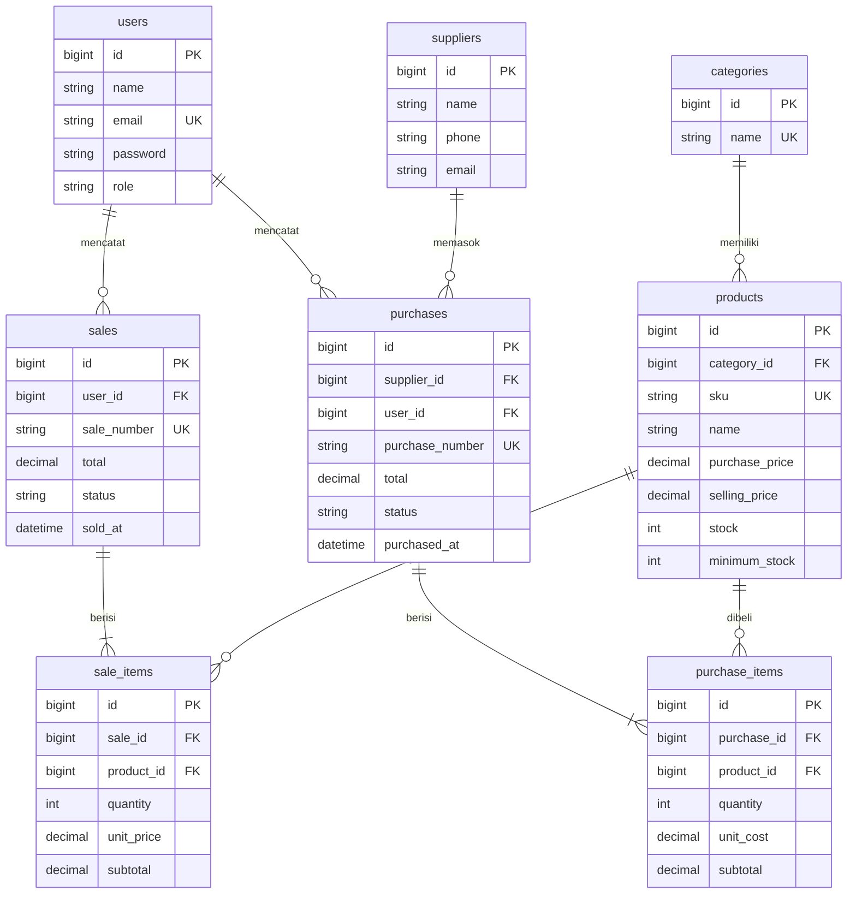

### Relasi Eloquent

| Model | Relasi |
|---|---|
| Category | `hasMany(Product)` |
| Product | `belongsTo(Category)`, `hasMany(SaleItem)`, `hasMany(PurchaseItem)` |
| Supplier | `hasMany(Purchase)` |
| Purchase | `belongsTo(Supplier)`, `belongsTo(User)`, `hasMany(PurchaseItem)` |
| PurchaseItem | `belongsTo(Purchase)`, `belongsTo(Product)` |
| User | `hasMany(Sale)`, `hasMany(Purchase)` |
| Sale | `belongsTo(User)`, `hasMany(SaleItem)` |
| SaleItem | `belongsTo(Sale)`, `belongsTo(Product)` |

`hasMany` dipakai di sisi "satu" (Sale), `belongsTo` di sisi "banyak" (SaleItem). Foreign key (`sale_id`) berada di tabel **detail** karena satu baris detail hanya milik satu header, sedangkan satu header punya banyak detail.

Index & constraint: `sku` unique, `email` unique, `*_number` unique, FK dengan `restrictOnDelete`, index pada `status`, `sold_at`, `purchased_at`, `products.name`, `users.role`. Kolom `stock` bertipe `unsigned` sehingga stok negatif ditolak juga oleh database.

## 9. Arsitektur

```
Browser → routes/web.php → Middleware (auth, can:admin)
        → Controller → Form Request / validate()
        → Service (SaleService, PurchaseService: business logic + DB::transaction)
        → Eloquent Model → MySQL → Blade view
```

```
app/Http/Controllers/    Auth, Dashboard, Product, Category, Supplier, User, Purchase, Sale
app/Http/Requests/       ProductRequest, StoreSaleRequest, StorePurchaseRequest
app/Services/            SaleService, PurchaseService   (logika transaksi & stok)
app/Models/              User, Category, Supplier, Product, Purchase(+Item), Sale(+Item)
app/Providers/           AppServiceProvider (Gate 'admin', pagination Bootstrap)
database/migrations/     skema + FK + index
database/seeders/        user demo, kategori, pemasok, produk
resources/views/         layout reusable + halaman per modul
routes/web.php           named routes + resource routes + grup middleware
tests/Feature/           InventorySalesTest.php
```

## 10. Testing

Test memakai SQLite in-memory (butuh ekstensi `pdo_sqlite`), tidak menyentuh database MySQL.

```bash
php artisan test
```

| Skenario | Test |
|---|---|
| Guest tidak bisa buka dashboard | `test_guest_cannot_open_dashboard` |
| Password salah ditolak | `test_wrong_password_is_rejected` |
| SKU duplikat ditolak | `test_duplicate_sku_is_rejected` |
| Harga negatif ditolak | `test_negative_price_is_rejected` |
| Pembelian menambah stok | `test_purchase_increases_stock` |
| Penjualan mengurangi stok, total dihitung server | `test_sale_decreases_stock_and_total_is_computed_by_server` |
| Stok tidak cukup ditolak tanpa perubahan data | `test_sale_with_insufficient_stock_is_rejected_without_changes` |
| Satu item gagal → rollback seluruh transaksi | `test_failed_item_rolls_back_whole_transaction` |
| Produk sama di dua baris tidak lolos cek stok | `test_same_product_on_two_lines_cannot_bypass_stock_check` |
| Batal penjualan memulihkan stok | `test_admin_cancel_sale_restores_stock` |
| Staff tidak bisa akses fungsi Admin | `test_staff_cannot_access_admin_functions` |
| Staff tidak bisa membatalkan / melihat transaksi orang lain | `test_staff_cannot_cancel_transaction`, `test_staff_cannot_view_other_staff_transaction` |
| Search, filter, pagination | `test_search_filter_and_pagination`, `test_sales_filter_by_status_and_validation_of_dates` |
| Dashboard dari database | `test_dashboard_numbers_come_from_database` |

**Bukti hasil pengujian:**

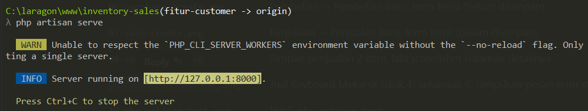

## 11. Screenshots

Login & dashboard
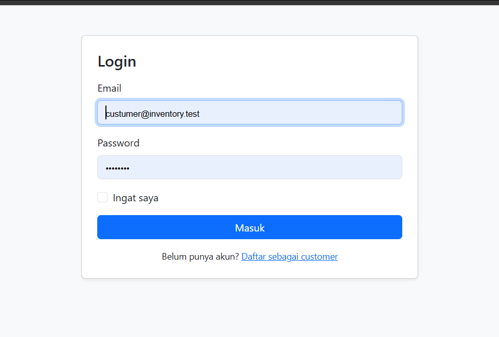
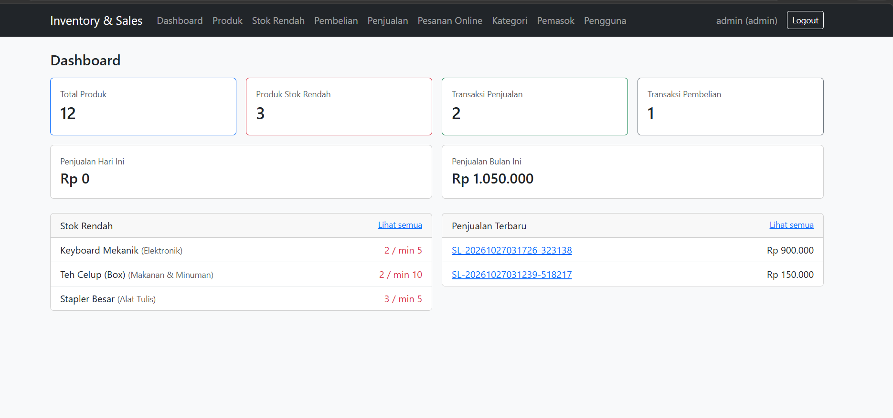

Master data
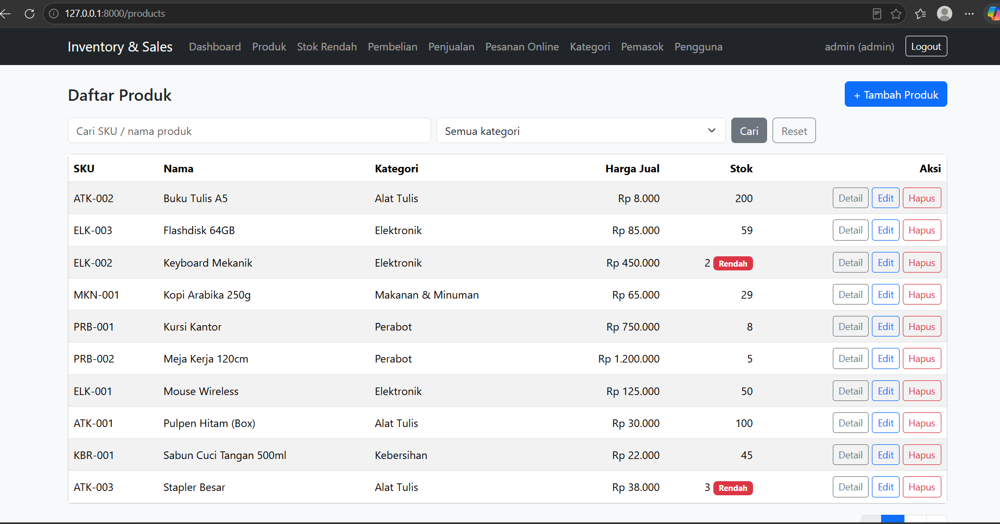
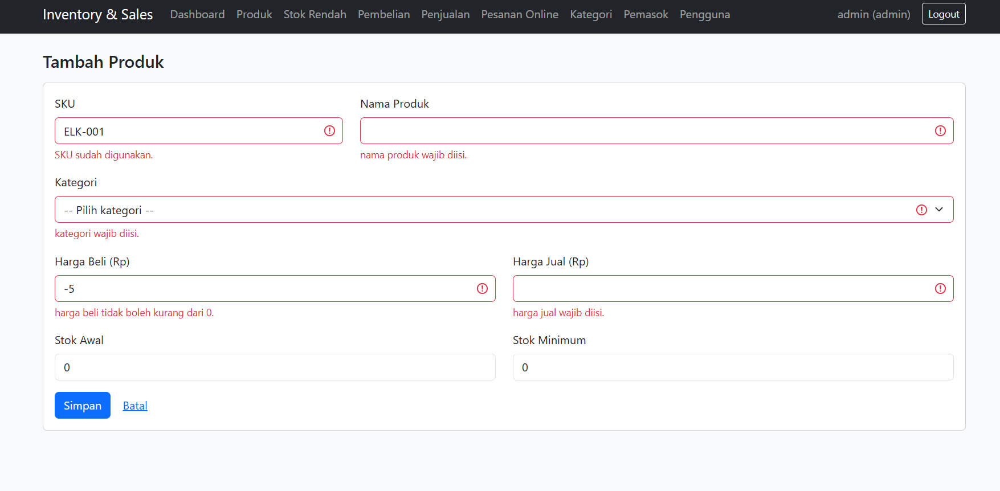
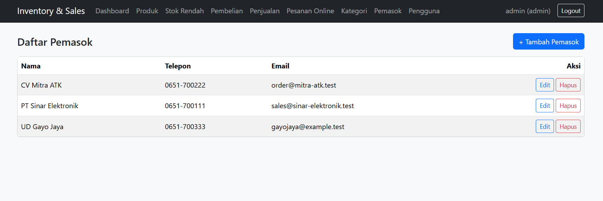

Transaksi
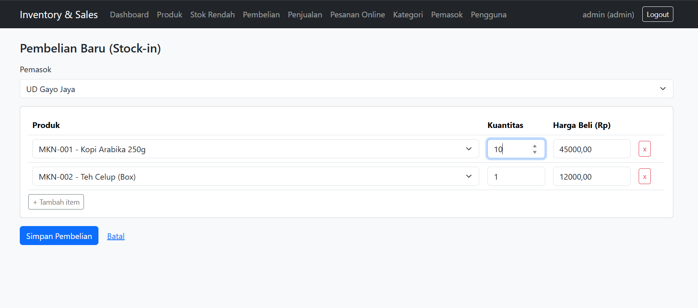
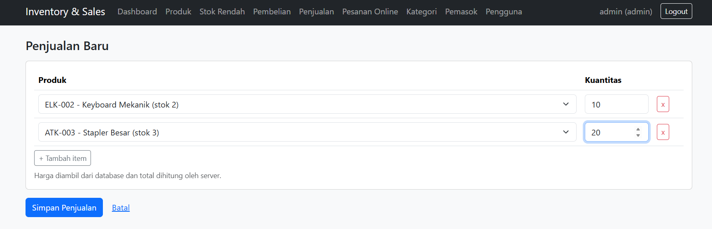
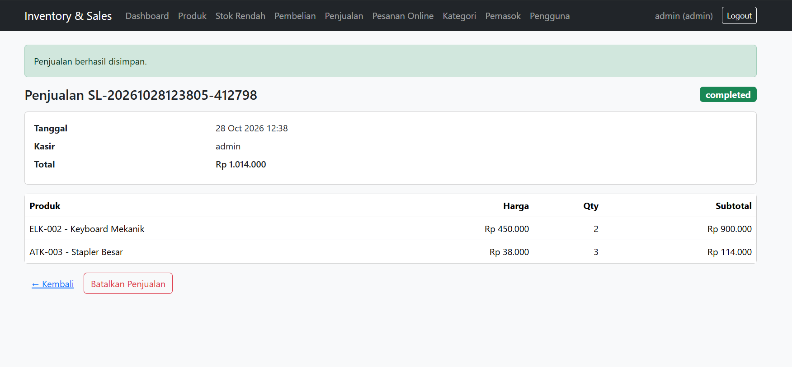
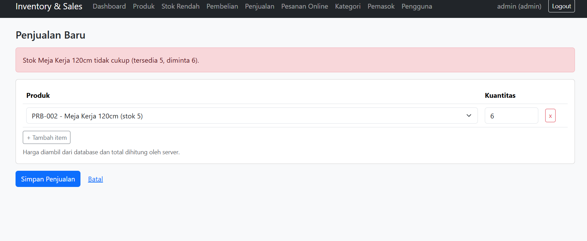

Akses
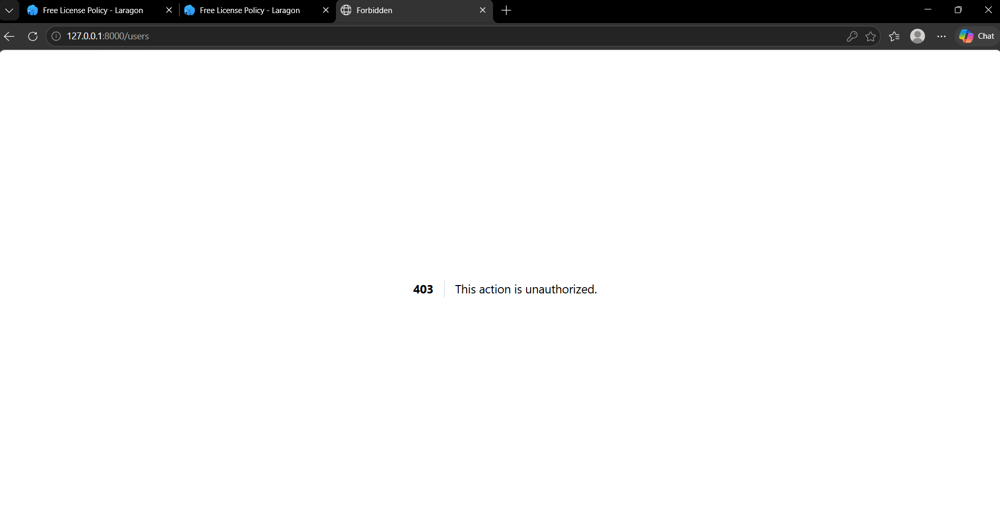

## 12. Security

- CSRF token (`@csrf`) di semua form POST/PUT/DELETE.
- Output di-escape oleh Blade (`{{ }}`).
- Password di-hash (cast `hashed`), session di-regenerate saat login, rate limit login (`throttle:10,1`).
- Mass-assignment dilindungi `$fillable`.
- Query memakai Eloquent / parameter binding (aman dari SQL injection).
- Kredensial hanya di `.env` (tidak di-commit).

## 13. Known Limitations

- Tidak ada payment gateway, multi-gudang, multi-currency, akuntansi, atau API.
- Transaksi yang sudah selesai tidak dapat diedit, hanya dibatalkan.
- Pembatalan pembelian ditolak jika stok saat ini lebih kecil dari jumlah yang dibeli.
- Role hanya `admin` dan `staff`; belum ada fitur reset password / registrasi mandiri.
- Nomor transaksi berbasis waktu + angka acak (dijaga unique index database).
- Bootstrap dimuat via CDN sehingga butuh internet saat menjalankan UI.
